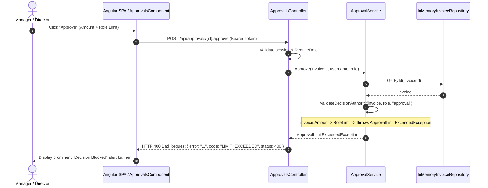
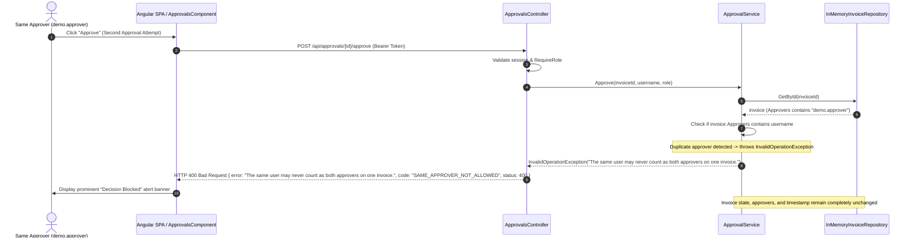
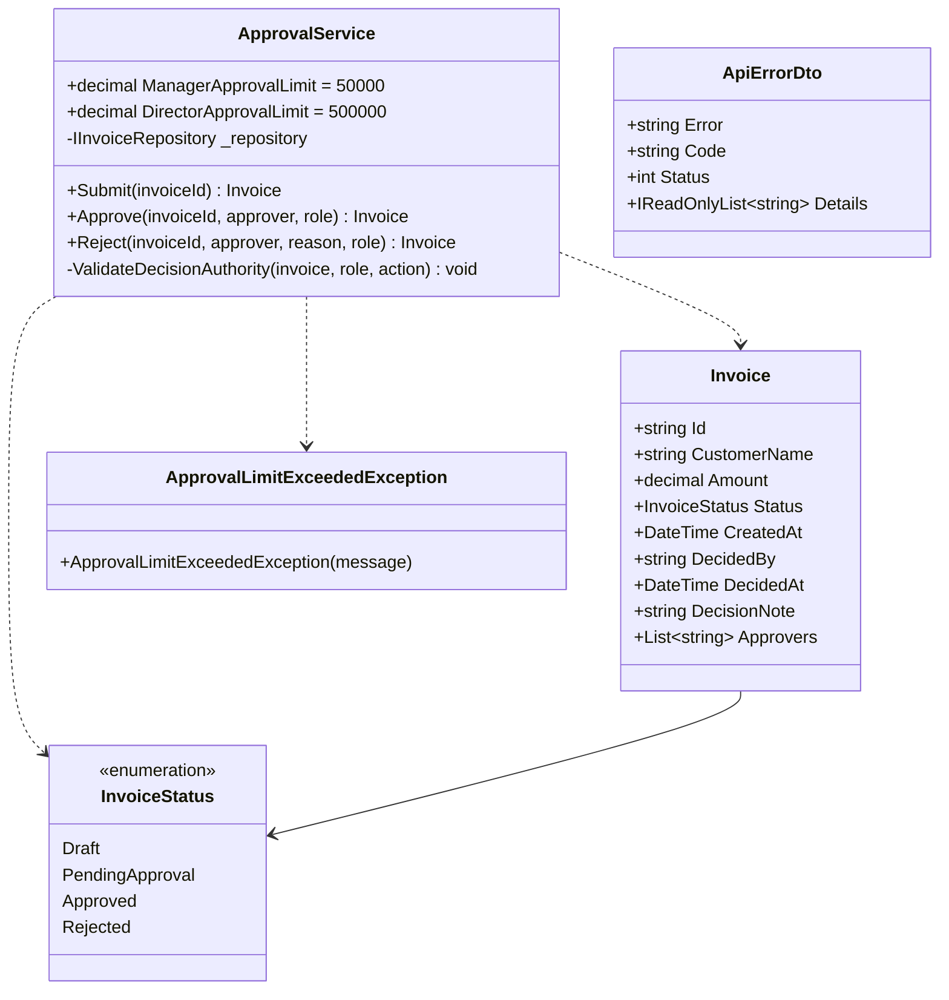

# Sequence and UML Diagrams: Approval Limits by Role

## 1. Sequence Diagram: Over-Limit Approval Rejection

## 2. Sequence Diagram: Dual Approver Segregation Rejection

## 3. UML Diagram: Class & Component Structure

